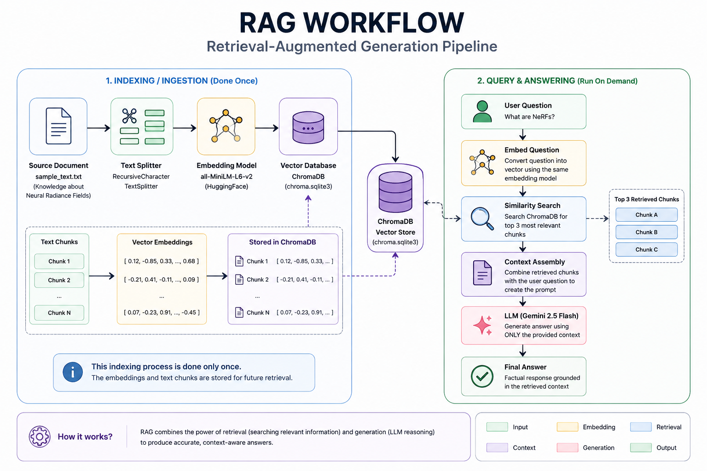

# Learning RAG - Retrieval-Augmented Generation with Vector DB

A beginner-friendly, end-to-end RAG project built with LangChain, ChromaDB, HuggingFace Embeddings and Google Gemini. Learn how LLMs can answer questions from your own documents instead of hallucinating.

Repo: https://github.com/HelloSamved/Learning-RAG

## Table of Contents

1. [What is RAG?](#what-is-rag)
2. [What This Project Does](#what-this-project-does)
3. [RAG Workflow](#rag-workflow)
4. [Tech Stack Explained](#tech-stack-explained)
5. [Core Concepts Explained Briefly](#core-concepts-explained-briefly)
6. [Project Structure](#project-structure)
7. [File-by-File Explanation](#file-by-file-explanation)
8. [Installation](#installation)
9. [Setup API Key](#setup-api-key)
10. [Usage](#usage)
11. [Example Run](#example-run)
12. [Use Your Own Data](#use-your-own-data)
13. [Customization](#customization)
14. [Limitations and Next Steps](#limitations-and-next-steps)
15. [What You Will Learn](#what-you-will-learn)
16. [Author](#author)
17. [License](#license)

## What is RAG?

Retrieval-Augmented Generation (RAG) has two parts: Retrieval and Generation.

Normal LLMs answer only from what they memorized during training. That causes three problems:

- Hallucinations (made-up answers)
- Outdated knowledge
- No knowledge of your private files

RAG fixes this in 2 steps:

1. Retrieval: Search your documents for the most relevant pieces (called chunks) for a user question.
2. Generation: Give only those chunks plus the question to an LLM to generate a grounded, factual answer.

In short: RAG is search over your docs plus an LLM that answers only from what it found.

## What This Project Does

This repo is a minimal, learning-focused RAG:

- Takes a text file (sample_text.txt - currently One Piece story arcs)
- Splits it into small chunks
- Converts chunks into vector embeddings
- Stores them in a local Chroma Vector DB
- On user question, retrieves top 3 relevant chunks and asks Gemini 2.5 Flash to answer only from that context

No frontend, no complexity. Just 4 clean Python files, ideal for learning.

## RAG Workflow



The pipeline has 2 phases:

### Phase 1: Indexing / Ingestion (Done Once)

```text
Source Document (.txt)
  -> Text Splitter (chunk_size=500, overlap=50)
  -> Embedding Model (all-MiniLM-L6-v2)
  -> Vector Database (ChromaDB in chroma_db/)
```

Stored once on disk (chroma.sqlite3 plus embedding files) and reused for all future queries.

### Phase 2: Query and Answering (Run On Demand)

```text
User Question
  -> Embed Question (same embedding model)
  -> Similarity Search in ChromaDB (top k=3)
  -> Context Assembly (chunks + question into prompt)
  -> LLM (Gemini 2.5 Flash)
  -> Final Grounded Answer
```

Golden rule in this project: If the answer is not in the context, the LLM says "I don't know". This prevents hallucination.

## Tech Stack Explained

| Technology | What it is | Why it is used here |
|---|---|---|
| Python | Programming language | Main language for the whole project |
| LangChain | Framework to build LLM apps | Provides loaders, splitters, retrievers and chains |
| langchain-community | Community integrations | Provides TextLoader, HuggingFaceEmbeddings, Chroma |
| langchain-text-splitters | Text chunking library | Provides RecursiveCharacterTextSplitter |
| langchain-google-genai | Google Gemini connector | Provides ChatGoogleGenerativeAI for Gemini 2.5 Flash |
| langchain-classic | Stable chains | Provides create_retrieval_chain and create_stuff_documents_chain |
| ChromaDB | Open-source vector database | Stores text and vectors locally, fast similarity search, persists in ./chroma_db |
| HuggingFace all-MiniLM-L6-v2 | Sentence embedding model (384-dim, 80MB) | Free, fast, runs locally, no API needed. Converts text to numbers that capture meaning |
| sentence-transformers | Embedding runtime | Runs the MiniLM model locally |
| Gemini 2.5 Flash | Google fast LLM | Generates final answer from retrieved context with temperature 0.7 |
| sample_text.txt | Demo knowledge base | Large sample text to test retrieval (One Piece arcs) |

## Core Concepts Explained Briefly

1. Document Loading: Reading raw files into LangChain Document objects. Here TextLoader loads .txt files.
2. Chunking / Text Splitting: LLMs and embeddings cannot handle huge files at once. We split into small pieces of 500 characters. chunk_overlap of 50 keeps context across boundaries so sentences do not break.
3. Embeddings: Convert text into a list of numbers (a vector), for example [0.12, -0.85, 0.33, ...]. Similar meaning results in similar vectors. all-MiniLM-L6-v2 outputs 384 numbers per chunk and runs locally.
4. Vector Database: A special database that stores vectors plus original text and finds nearest neighbors by cosine similarity. Here ChromaDB is used, persisted locally, no cloud needed.
5. Persist Directory (./chroma_db/): Chroma saves to disk (chroma.sqlite3 plus .bin files) so you index once and query many times.
6. Similarity Search / Retriever: The user question is also embedded. The DB returns the k=3 closest chunks. This is semantic search, not keyword search.
7. Prompt Engineering: The system prompt forces grounding: "Answer using ONLY the provided context. If you don't know, say you don't know."
8. Stuff Documents Chain: The simplest RAG chain. It literally "stuffs" all 3 retrieved chunks into the prompt context.
9. Retrieval Chain: Orchestrates retriever plus stuff chain: retrieve, format, call LLM, return answer with context.
10. Temperature (0.7): Controls creativity. 0 is factual and deterministic, 1 is creative. 0.7 is balanced for Q and A.
11. Hallucination Control: RAG plus a strict prompt means the LLM cannot invent facts outside your docs.

## Project Structure

```text
Learning-RAG/

  main_rag_project.py      Main entry point - orchestrates full RAG pipeline
  process_document.py      Step 2: Load and split document into chunks
  create_vector_db.py      Step 3: Embed chunks and create Chroma DB
  load_existing_db.py      Load persisted DB (no re-indexing needed)
  generate_answer.py       Step 4: Retrieve top 3 and generate answer with Gemini

  sample_text.txt          Demo knowledge base (One Piece arcs)
  requirements.txt         All Python dependencies

  chroma_db/               Persisted vector DB (auto-created)
    chroma.sqlite3
    7c3f9f82.../

  assets/
    rag_workflow.png       Architecture diagram used above
```

## File-by-File Explanation

### 1. process_document.py - Ingest and Chunk

- Uses TextLoader(file_path) to load .txt files.
- Uses RecursiveCharacterTextSplitter(chunk_size=500, chunk_overlap=50, length_function=len) to split.
- Prints first 2 chunks for inspection.
- Returns: List of Document chunks.
- Concept: Chunking preserves meaning while fitting embedding and LLM limits.

```python
from process_document import processdocument
chunks = processdocument("sample_text.txt")
```

### 2. create_vector_db.py - Embed and Store

- Loads HuggingFaceEmbeddings(model_name="all-MiniLM-L6-v2"). Downloads once, then runs locally.
- Calls Chroma.from_documents(documents=chunks, embedding=embedding_model, persist_directory="./chroma_db").
- Does: text to 384-dim vectors to saved on disk.
- Returns: db object.
- Note: Run only once unless your source file changes.

```python
from create_vector_db import createvectordb
db = createvectordb(chunks)
```

### 3. load_existing_db.py - Reuse DB

- Must use the SAME embedding model as creation, otherwise vectors will not match.
- Loads Chroma(persist_directory="./chroma_db", embedding_function=embedding_model).
- Use this for every query after first indexing. Saves time and compute.

```python
from load_existing_db import loadexistingdb
db = loadexistingdb()
```

### 4. generate_answer.py - Retrieve and Generate

- LLM: ChatGoogleGenerativeAI(model="gemini-2.5-flash", temperature=0.7)
- Retriever: db.as_retriever(search_kwargs={"k": 3}) for top 3 chunks.
- Prompt: System prompt says "Answer the user's question using ONLY the provided context. If you don't know, say you don't know."
- Chain: create_stuff_documents_chain(llm, prompt) plus create_retrieval_chain(retriever, chain)
- Invokes: rag_chain.invoke({"input": question}) and prints response["answer"].

```python
from generate_answer import generateanswer
generateanswer(db, "Who is Shanks and what did he give to Luffy?")
```

### 5. main_rag_project.py - Orchestrator

Full flow in one run:

1. Load GOOGLE_API_KEY from ragvenv/api_key.txt
2. Call processdocument("sample_text.txt")
3. Call createvectordb(chunks) - comment out after first run, use loadexistingdb() instead
4. Take input with input("Enter your question: ") and call generateanswer(db, question)

### 6. sample_text.txt - Knowledge Base

Currently contains One Piece arcs (Romance Dawn, Buggy, Kuro, Baratie, Arlong, about 250KB). Replace with any .txt file to make your own chatbot (notes, docs, policy, book).

### 7. requirements.txt - Dependencies

```text
langchain
chromadb
sentence-transformers
langchain-community
langchain-classic
langchain-text-splitters
langchain-google-genai
```

### 8. chroma_db/ - Persisted Vectors

Auto-generated. Do not edit manually. Delete the folder to re-index from scratch.

## Installation

```bash
# 1. Clone
git clone https://github.com/HelloSamved/Learning-RAG.git
cd Learning-RAG

# 2. Create virtual env (recommended)
python -m venv ragvenv
source ragvenv/bin/activate
# Windows: ragvenv\Scripts\activate

# 3. Install
pip install -r requirements.txt
```

First run will download all-MiniLM-L6-v2 (about 80MB) from HuggingFace. This is one-time only.

## Setup API Key

This project uses Google Gemini. Get a free key from Google AI Studio: https://aistudio.google.com/app/apikey

The current main_rag_project.py expects this file:

```text
ragvenv/api_key.txt
```

containing only your key:

```bash
echo "YOUR_GOOGLE_API_KEY" > ragvenv/api_key.txt
```

Or set env directly (recommended improvement):

```bash
export GOOGLE_API_KEY="YOUR_KEY"
```

## Usage

```bash
python main_rag_project.py
```

Flow:

1. Document is chunked, DB is created, DB is re-loaded
2. You are asked: Enter your question:
3. Example: What did Shanks give to Luffy?
4. RAG retrieves relevant chunks and Gemini answers.

For second run onwards (faster): comment out createvectordb line and only use loadexistingdb():

```python
# db = createvectordb(chunks)  # only first time
db = loadexistingdb()           # every time after
```

## Example Run

```text
--- Step 2: Ingesting and Chunking Data ---
Successfully loaded document: sample_text.txt
Split the document into 523 individual chunks.

--- Step 3: Creating Embeddings and Vector Database ---
Loading embedding model...
Creating Chroma DB at ./chroma_db...
Database created and saved successfully!

Enter your question: Who is Shanks and what did he give Luffy?

--- Step 4: Retrieving and Generating Answer ---
Question: Who is Shanks and what did he give Luffy?

Answer:
Shanks is a pirate known as Red-Haired Shanks... He gave Luffy his prized straw hat and told him to return it when he becomes a great pirate.
```

## Use Your Own Data

1. Replace sample_text.txt with your file, for example my_notes.txt
2. Update in main_rag_project.py:

```python
chunks = processdocument("my_notes.txt")
```

3. Delete old DB:

```bash
rm -rf chroma_db
```

4. Re-run:

```bash
python main_rag_project.py
```

Works with any plain text. For PDFs, CSVs or DOCX, swap TextLoader with PyPDFLoader, CSVLoader, etc. from langchain_community.document_loaders.

## Customization

| What to change | Where | Example |
|---|---|---|
| Chunk size / overlap | process_document.py | chunk_size=1000, chunk_overlap=100 for longer context |
| Retrieved chunks | generate_answer.py | search_kwargs={"k": 5} for more context |
| LLM model | generate_answer.py | gemini-1.5-pro, gemini-2.0-flash |
| Creativity | generate_answer.py | temperature=0.0 for strict factual answers |
| Embedding model | create_vector_db.py and load_existing_db.py | all-mpnet-base-v2 for higher quality (slower) |
| Prompt | generate_answer.py system_prompt | Add citations, bullet format, etc. |

## Limitations and Next Steps

Current limitations:

- Only .txt files supported
- No chat history (single-turn Q and A only)
- No source citations in answer
- No evaluation of retrieval quality
- Basic API key handling

Roadmap ideas:

- Add PDF, DOCX and URL loaders
- Add Streamlit or FastAPI UI
- Show source chunks with page numbers
- Add conversational memory
- Add hybrid search (vector plus BM25) with reranking
- Add evaluation (RAGAS, faithfulness)
- Move to .env with python-dotenv for keys
- Dockerize and deploy

Contributions welcome.

## What You Will Learn

After studying this repo, you will understand:

- What RAG is and why it is better than fine-tuning for private data
- Embeddings, vectors, and semantic search
- Chunking strategies (size vs overlap tradeoff)
- How ChromaDB persists and retrieves vectors
- How LangChain retrievers and chains work
- How to ground an LLM to prevent hallucinations
- Full lifecycle: Ingest, Embed, Store, Retrieve, Generate

## Author

Samved - https://github.com/HelloSamved

Built for learning RAG from scratch. If this helped you, please star the repo.

## License

MIT License - free to use, modify, and distribute for learning and projects.
